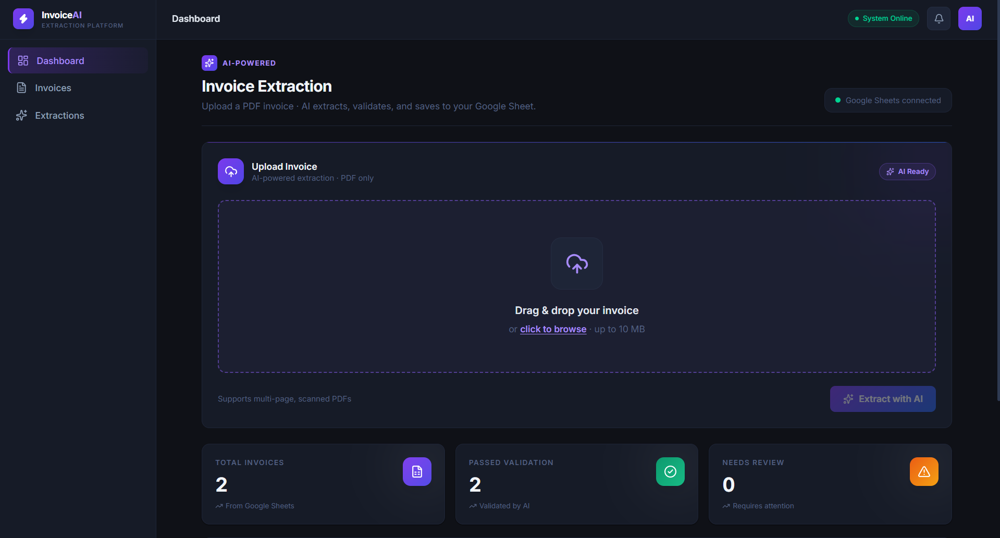
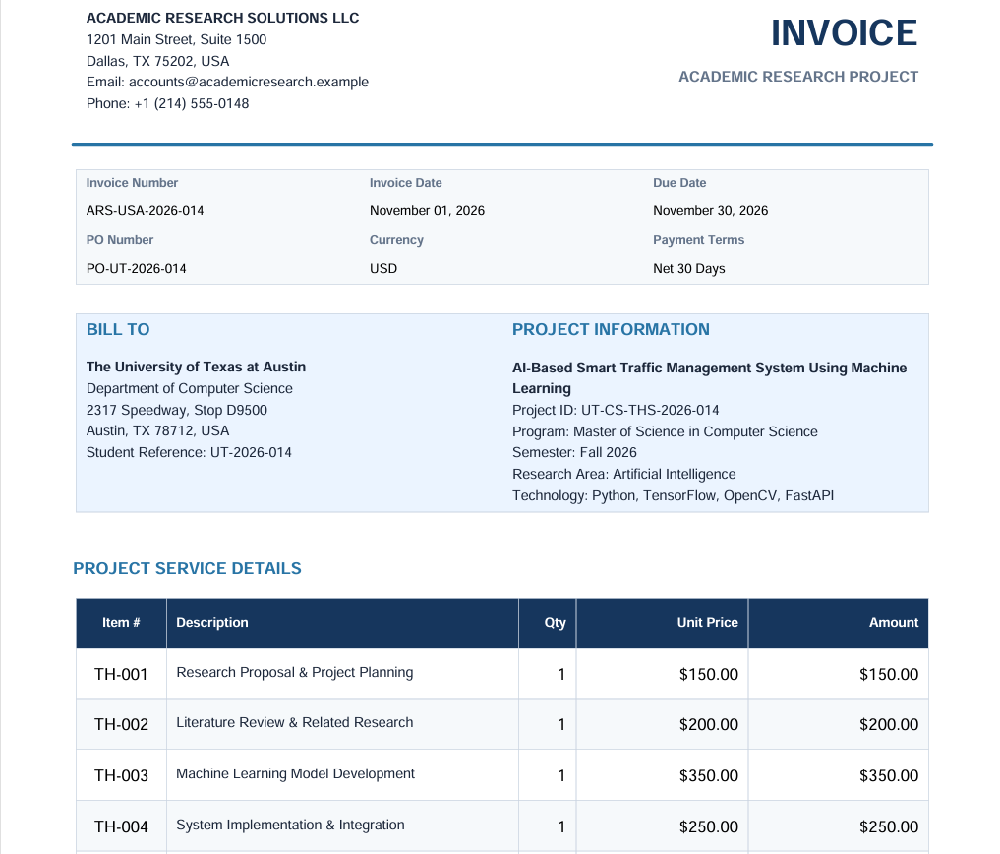
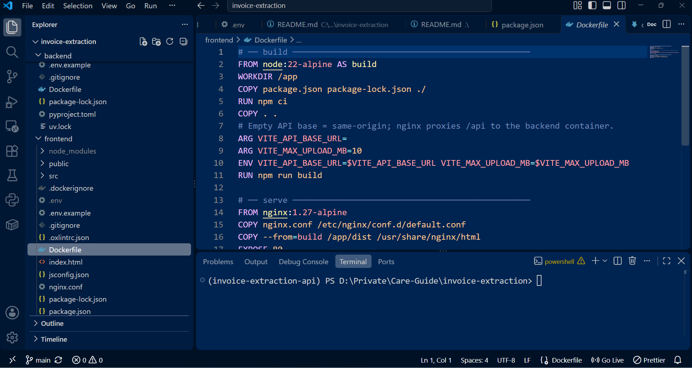
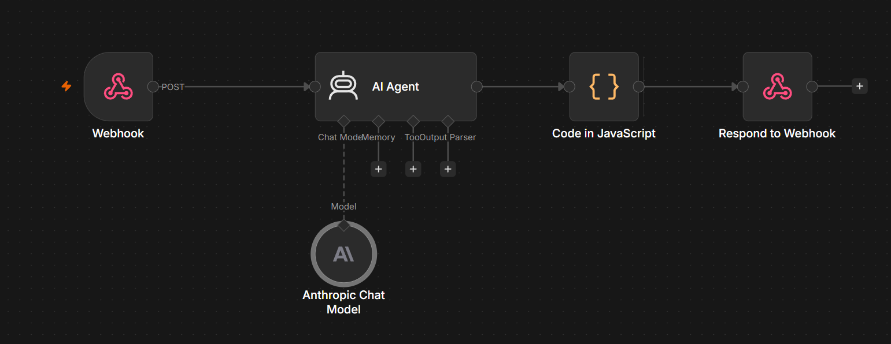

# 🧾 Invoice Intelligence

> **AI-Powered Automated Invoice Processing & Financial Automation Platform**

**Invoice Intelligence** is an enterprise-ready web application designed to automatically extract, validate, and persist key financial records from unstructured PDF invoices into structured databases and spreadsheet systems. 

By integrating modern frontend frameworks with AI workflow orchestration, the application eliminates manual data entry, minimizes human financial calculation errors, and implements a reliable **human-in-the-loop** approval system.

---

## 📸 Demo & Screenshots

| 1. Intelligent PDF Parsing & Extraction | 2. Sample Invoice |
| :---: | :---: |
|  |  |

| 3. Source Code| 4. Automated Workflow Integration |
| :---: | :---: |
|  |  |

## ✨ Key Features

- 📄 **Automated PDF Parsing:** Fast, high-accuracy text extraction from native digital PDF invoices.
- 🤖 **AI-Driven Data Extraction:** Intelligent identification of supplier, customer, line items, taxes, subtotal, and total amounts.
- 🧮 **Automated Financial Validation:** Real-time cross-verification of mathematical consistency across line items and overall totals.
- ✏️ **Human-in-the-Loop Review:** Interactive review UI allowing users to verify or edit extracted information before persistence.
- 📊 **Spreadsheet & DB Synchronization:** Automatic persistence of verified financial records to Google Sheets via secure webhooks.
- 🔎 **Invoice Management:** Complete dashboard interface for searching, filtering, and reviewing historical invoice entries.

---

## 🏗️ Architecture & Workflow

```
┌───────────┐      Upload PDF      ┌─────────────────┐      Extract Text     ┌───────────────────┐
│           │ ───────────────────> │                 │ ───────────────────>  │  pdfplumber       │
│  React 19 │                      │  FastAPI        │                       │  Processing Engine│
│ Dashboard │ <─────────────────── │  Backend        │ <───────────────────  └───────────────────┘
└───────────┘      Verified Data   └─────────────────┘      Parsed Text               │
      │                                     │                                         │
      │ Submit                              │ Webhook                                 │
      ▼                                     ▼                                         ▼
┌──────────────┐                     ┌───────────────┐                       ┌───────────────────┐
│  Google      │ <────────────────── │ n8n Workflow  │ <──────────────────── │ LLM / AI Agent    │
│  Sheets API  │    Persist Record   │ Orchestration │   Structured Data     │ Information Extractor│
└──────────────┘                     └───────────────┘                       └───────────────────┘
```

---

## 🛠️ Tech Stack

- **Frontend:** React 19, Vite, Tailwind CSS v4, TanStack Query, React Hook Form
- **Backend:** Python 3.11+, FastAPI, Pydantic v2, `pdfplumber`, `uv`
- **Automation & AI:** n8n Workflow Orchestrator, LLM Integration Agents
- **Persistence:** Google Sheets API integration
- **Containerization & Deployment:** Docker, Docker Compose, Nginx

---

## 📂 Project Structure

```text
invoice-intelligence/
├── backend/                  # FastAPI Application Server
│   ├── app/
│   │   ├── api/              # API Endpoints & Routes
│   │   ├── core/             # Configuration & Settings
│   │   ├── schemas/          # Data Validation & Pydantic Models
│   │   └── services/         # Extraction & Processing Engines
│   ├── tests/                # Automated Backend Test Suite
│   └── Dockerfile
├── frontend/                 # React SPA Dashboard
│   ├── src/
│   │   ├── components/       # UI Components
│   │   ├── features/         # Invoice Processing Modules
│   │   └── services/         # API Service Integrations
│   └── Dockerfile
├── docker-compose.yml        # Multi-container Orchestration Config
└── README.md
```

---

## ⚙️ Environment Variables

### Backend Configuration (`backend/.env`)

| Variable | Required | Default | Description |
| :--- | :---: | :--- | :--- |
| `N8N_EXTRACT_WEBHOOK_URL` | **Yes** | — | Webhook URL for AI extraction workflow |
| `N8N_SAVE_WEBHOOK_URL` | **Yes** | — | Webhook URL for invoice persistence |
| `N8N_LIST_WEBHOOK_URL` | **Yes** | — | Webhook URL for listing saved invoices |
| `ENVIRONMENT` | No | `development` | Runtime environment (`development` / `production`) |
| `CORS_ORIGINS` | No | `http://localhost:5173` | Allowed origins for cross-origin requests |

### Frontend Configuration (`frontend/.env`)

| Variable | Required | Default | Description |
| :--- | :---: | :--- | :--- |
| `VITE_API_BASE_URL` | **Yes** | `http://localhost:8000` | FastAPI backend service URL |

---

## 🐳 Quick Start with Docker (Recommended)

The project includes pre-configured Docker builds for easy deployment across environments.

### 1. Clone the Repository
```bash
git clone https://github.com/moonirul/invoice-intelligence.git
cd invoice-intelligence
```

### 2. Configure Environment Variables
Copy and update the `.env` configuration file:
```bash
cp backend/.env.example backend/.env
```

### 3. Build & Run
Spin up all services (Frontend, Backend API, Nginx Proxy) in background mode:
```bash
docker compose up -d --build
```

Access the application dashboard at: **`http://localhost:8080`**

---

## 🛠️ Local Development Setup

If you prefer to run services individually without Docker:

### Prerequisites
- **Python:** `3.11+`
- **Node.js:** `22+`
- **Package Managers:** `uv` (Python), `npm` (Node)

### 1. Backend Setup
```bash
cd backend
cp .env.example .env

# Install dependencies using uv
uv sync

# Run backend development server
uv run uvicorn app.main:app --reload --port 8000
```
- Interactive API Docs (Swagger): `http://localhost:8000/docs`

### 2. Frontend Setup
Open a new terminal window:
```bash
cd frontend
cp .env.example .env

# Install dependencies and start server
npm install
npm run dev
```
- Local Application Interface: `http://localhost:5173`

---

## 🧪 Testing & Quality Assurance

```bash
# Run backend tests & linting
cd backend
uv run pytest
uv run ruff check .

# Run frontend linting & build verification
cd frontend
npm run lint
npm run build
```

---

## 📄 License

Distributed under the **MIT License**. See `LICENSE` for more information.

---

## 👨‍💻 Author

**Moonirul**  
- GitHub: [@moonirul](https://github.com/moonirul)